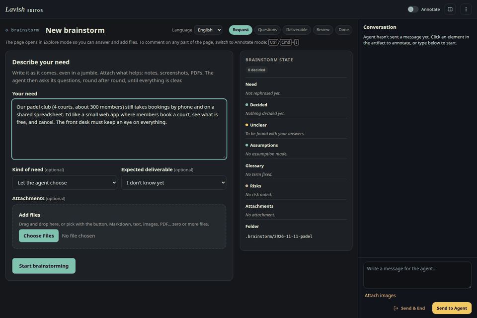

# brainstorm

[](https://github.com/JejomStark/brainstorm/actions/workflows/test.yml)

*Version française plus bas : [En français](#en-français).*

A Claude Code skill that turns a vague need into a clear deliverable. You type `/brainstorm`, a local [Lavish](https://github.com/kunchenguid/lavish-axi) page opens, you write your need and drop your files **in the page**, and the agent asks its questions round after round, with real form controls, until nothing is unclear. Then it writes the deliverable that fits: spec, ADR, PRD, issue, task plan, agent brief or glossary.

It couples three existing pieces: the relentless round-by-round questioning of Matt Pocock's *grilling* skill, the ADR and glossary formats of his *domain-modeling* skill, and Kun Chen's Lavish interactive review page. See [Credits](#credits).

The page, the agent's questions and the deliverables work in **English or French** (more languages are one file away).

## Demo

A full session on a made-up example, "a booking app for a padel club":



| Step | English | Français |
|---|---|---|
| 1. Request | [en-01-request](docs/screenshots/en-01-request.png) | [fr-01-request](docs/screenshots/fr-01-request.png) |
| 2. Question round | [en-02-round1](docs/screenshots/en-02-round1.png), [en-03-round2](docs/screenshots/en-03-round2.png) | [fr-02-round1](docs/screenshots/fr-02-round1.png) |
| 3. Deliverable choice | [en-04-proposal](docs/screenshots/en-04-proposal.png) | [fr-03-proposal](docs/screenshots/fr-03-proposal.png) |
| 4. Review | [en-05-review](docs/screenshots/en-05-review.png) | [fr-04-review](docs/screenshots/fr-04-review.png) |
| 5. Done | [en-06-done](docs/screenshots/en-06-done.png) | [fr-05-done](docs/screenshots/fr-05-done.png) |

Switching the page language keeps what you typed: [language-switch](docs/screenshots/language-switch.png).

## What you get

1. `/brainstorm` opens a blank Lavish page.
2. In the page: a text area for the need, a real file picker (click or drag and drop, zero or more files: Markdown, text, images, PDF…), and two optional lists (kind of need, expected deliverable).
3. Each round brings 3 to 5 questions with real controls (single choice, checkboxes, free text), the agent's recommendation preselected, and a free detail per question. Everything goes out in **one submission**.
4. A "brainstorm state" panel stays visible: need rephrased, decided, unclear, assumptions, glossary, risks, attachments, previous rounds.
5. When nothing is unclear any more, the page proposes the deliverables that fit; the agent writes them into the session folder and shows them for review (Lavish annotations work too), applies your changes, then closes.

## Requirements

- [Claude Code](https://claude.com/claude-code).
- Node.js 20 or later.
- `lavish-axi` on the `PATH`: `npm install -g lavish-axi`. Tested with lavish-axi 0.1.96.

## Installation

With [skills.sh](https://skills.sh) (copies the skill into your project's `.claude/skills/`; add `-g` to install it for every project):

```bash
npx skills add JejomStark/brainstorm
```

Or with a symbolic link, so that pulling the repository updates the skill at once:

```bash
git clone https://github.com/JejomStark/brainstorm.git ~/src/brainstorm
ln -s ~/src/brainstorm/skills/brainstorm ~/.claude/skills/brainstorm
```

For a single project: `ln -s ~/src/brainstorm/skills/brainstorm <project>/.claude/skills/brainstorm`.

The skill is triggered by hand only (`disable-model-invocation`): it costs no context until you type `/brainstorm`.

## Usage

In Claude Code, from the project concerned:

```
/brainstorm
/brainstorm --lang fr
```

The agent gives the page URL, and everything happens in the page. Sessions are stored in `.brainstorm/<date-time>/` of the current project (add it to your `.gitignore` if you do not want to version them):

```
.brainstorm/2026-11-11-121102/
├── brainstorm.json   state of the session, single source of truth
├── page.html         page regenerated at each round, opened in Lavish
├── attachments/      attached files
└── deliverables/     spec.md, adr-0001-….md, CONTEXT.md…
```

### Language

- `--lang en` or `--lang fr` at launch sets the language of the page, of the agent's questions and of the deliverables.
- Without it, the agent uses the language of your message (or of your request in the page); otherwise English.
- A selector in the page header switches the interface at once, keeps what you typed, and tells the agent to continue in that language from your next submission.

## How it works

```
Lavish page ──(one submission: answers + files in base64)──▶ brainstorm.mjs wait ──▶ agent
     ▲                                                          │ saves the files into attachments/
     │                                                          ▼
     └──── Lavish reloads the page ◀── brainstorm.mjs render ◀── agent writes brainstorm.json
```

- The agent never writes the page: it writes `brainstorm.json`, which `render` validates (errors named field by field) and injects into the page template, with styles, scripts and translations inline.
- Files travel inside the Lavish prompt text, base64-encoded between markers. `wait` decodes them, writes them into `attachments/` and only shows the agent their paths, plus the content of short texts: the agent's context is never flooded with base64.
- The picker is a native `<input type="file" multiple>` inside a `<label>` that is also the drop zone. Lavish leaves native controls interactive.
- The page opens in Lavish's Explore mode (`data-lavish-annotate="off"`), so you can answer and drop files right away; Ctrl/Cmd+I switches to Annotate mode to comment on any part of the page.

### Language design

The instruction files the agent reads (`SKILL.md`, `profiles/`, `writers/`, `blocks/`, `reference/`) are written once, in English, with one rule: *write everything the user reads in the session language* (`lang` in `brainstorm.json`). The page's own strings live in one translation file per language, `skills/brainstorm/page/i18n/<code>.json`. To add a language, copy `en.json` to `<code>.json` and translate the values: the tests check that every file has exactly the same keys, and `brainstorm.mjs languages` lists it at once.

### Limits

- The Lavish server rejects a submission larger than 2 MB. The page keeps about 1 MB of files per submission:
  - an image that is too heavy is reduced in the browser (JPEG, 1600 px on the longest side);
  - any other file that is too heavy is reported in the page and in the submission: copy it by hand into `attachments/`, the agent reads it at the next round;
  - you can add files at any round.
- One Lavish page per session; the page needs Lavish to send anything (opened on its own, it shows the text to copy into the conversation, without the files).
- In Lavish the page cannot use browser storage, so a language picked in the selector lasts until your next submission, which is when the agent switches the session to it.

## Skill layout

| Path | Role |
|---|---|
| `skills/brainstorm/SKILL.md` | the loop, step by step, and the language rule |
| `skills/brainstorm/reference/state-json.md` | schema of the state and format of the submissions |
| `skills/brainstorm/blocks/questioner.md` | decision tree, frontier, writing the questions |
| `skills/brainstorm/blocks/attachments.md` | reading the attachments |
| `skills/brainstorm/profiles/` | branches to cover and default deliverables: product, technical, content |
| `skills/brainstorm/writers/` | one template per deliverable: spec, ADR, PRD, issue, plan, brief, glossary |
| `skills/brainstorm/page/` | page template, styles, scripts and `i18n/` translations (no dependency, no CDN) |
| `skills/brainstorm/scripts/` | `brainstorm.mjs` (init, render, wait, reply, languages) and its modules |

To add a profile or a deliverable: one more Markdown file in `profiles/` or `writers/`, and one line in the table of `SKILL.md`.

## Privacy

The page loads no external resource and the skill never runs `lavish-axi share`. Your need, your files and the deliverables stay on your machine. Lavish itself sends anonymous usage telemetry (command name, version, platform; no content); set `LAVISH_AXI_TELEMETRY=0` to turn it off. With Tailscale running, Lavish also listens on your tailnet address; set `LAVISH_AXI_HOST=127.0.0.1` to keep it on loopback.

## Tests

```bash
npm test
```

## Credits

- **[mattpocock/skills](https://github.com/mattpocock/skills)** by Matt Pocock (MIT): the questioning method of the *grilling* skill (decision tree, frontier, a recommendation for every question) and the ADR and `CONTEXT.md` formats of the *domain-modeling* skill.
- **[Lavish](https://github.com/kunchenguid/lavish-axi)** (`lavish-axi`) by Kun Chen (MIT): the local interactive review page, its annotations and its feedback loop with the agent.

License notices: [THIRD_PARTY_NOTICES.md](THIRD_PARTY_NOTICES.md).

## License

[MIT](LICENSE).

---

## En français

**brainstorm** est une skill Claude Code qui transforme un besoin flou en livrable clair. On tape `/brainstorm`, une page [Lavish](https://github.com/kunchenguid/lavish-axi) locale s'ouvre, on y écrit son besoin et on y dépose ses fichiers, puis l'agent pose ses questions par tours, avec de vrais contrôles, jusqu'à ce que plus rien ne soit flou. Il rédige alors le livrable adapté : spec, ADR, PRD, issue, plan de tâches, brief d'agent ou glossaire.

Elle assemble l'interrogatoire par tours de la skill *grilling* et les formats ADR et glossaire de la skill *domain-modeling* de Matt Pocock, avec la page de revue interactive Lavish de Kun Chen (voir [Credits](#credits)).

### Démo

Un cadrage complet sur un exemple fictif, « une appli de réservation pour un club de padel » : captures [fr-01](docs/screenshots/fr-01-request.png) à [fr-05](docs/screenshots/fr-05-done.png), et le [changement de langue](docs/screenshots/language-switch.png).

### Prérequis

Claude Code, Node.js 20 ou plus, et `lavish-axi` dans le `PATH` (`npm install -g lavish-axi`, testé avec la 0.1.96).

### Installation

```bash
npx skills add JejomStark/brainstorm
```

ou par lien symbolique : `ln -s <dépôt>/skills/brainstorm ~/.claude/skills/brainstorm`.

### Usage

```
/brainstorm --lang fr
```

Sans `--lang`, l'agent prend la langue de votre message, sinon l'anglais. Un sélecteur dans la page change la langue de l'interface tout de suite, garde ce que vous avez saisi, et demande à l'agent de continuer dans cette langue dès votre prochain envoi. Les cadrages sont rangés dans `.brainstorm/<date-heure>/` du projet courant : `brainstorm.json` (l'état), `page.html`, `attachments/` (pièces jointes), `deliverables/` (livrables).

### Fonctionnement

L'agent n'écrit jamais la page : il écrit `brainstorm.json`, que `render` valide puis injecte dans le modèle de page. Les fichiers joints voyagent en base64 dans l'envoi Lavish ; `wait` les range dans `attachments/` et ne montre à l'agent que leurs chemins. La page s'ouvre en mode Explore ; Ctrl/Cmd+I passe en mode Annotate pour commenter n'importe quel endroit.

Les consignes de l'agent sont écrites une fois, en anglais, avec une règle : tout ce que l'utilisateur lit est écrit dans la langue de la session. Les textes de la page sont dans un fichier de traduction par langue (`skills/brainstorm/page/i18n/`).

### Limites

Le serveur Lavish refuse un envoi de plus de 2 Mo : la page garde environ 1 Mo de fichiers par envoi, réduit les images trop lourdes, et signale les autres fichiers trop lourds, à copier à la main dans `attachments/`. Tout reste sur la machine : la page ne charge rien d'extérieur et la skill n'utilise jamais `lavish-axi share` (télémétrie de Lavish désactivable avec `LAVISH_AXI_TELEMETRY=0`).

### Licence

[MIT](LICENSE). Mentions des projets tiers : [THIRD_PARTY_NOTICES.md](THIRD_PARTY_NOTICES.md).
